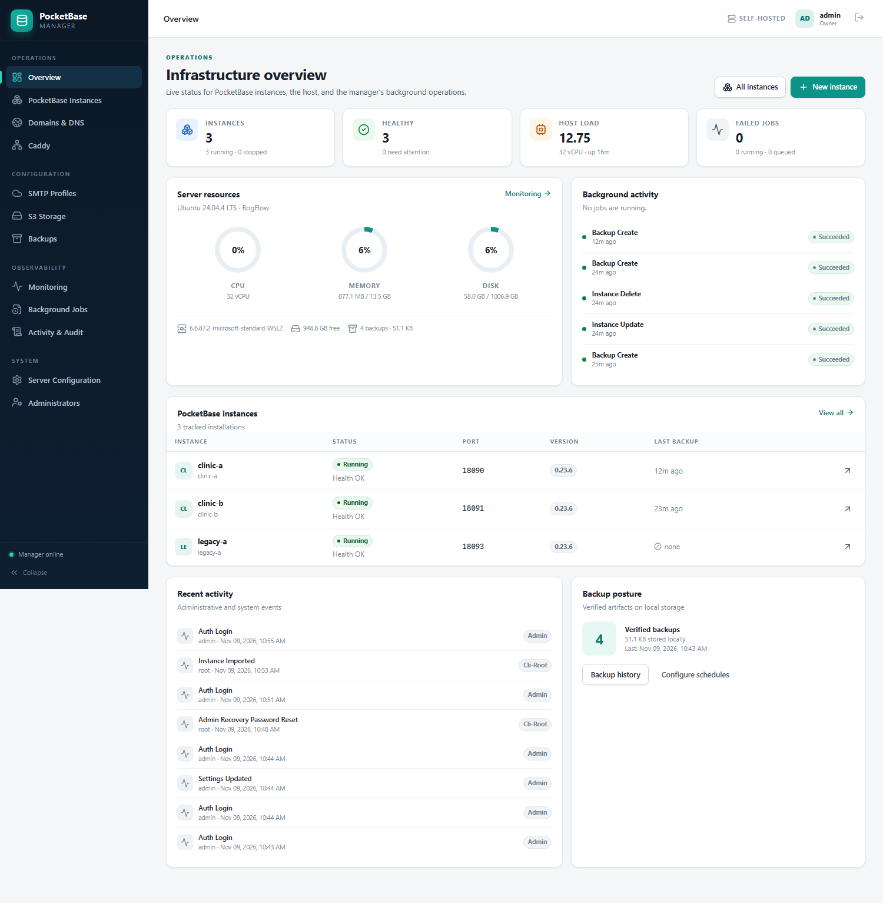
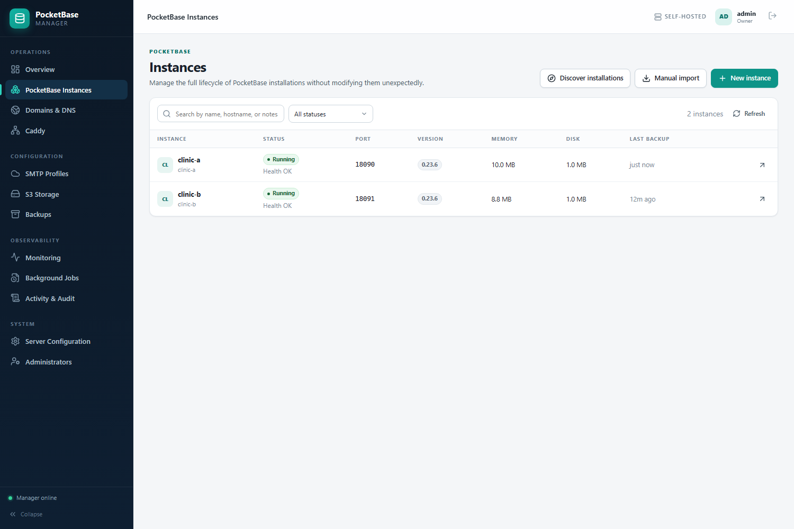
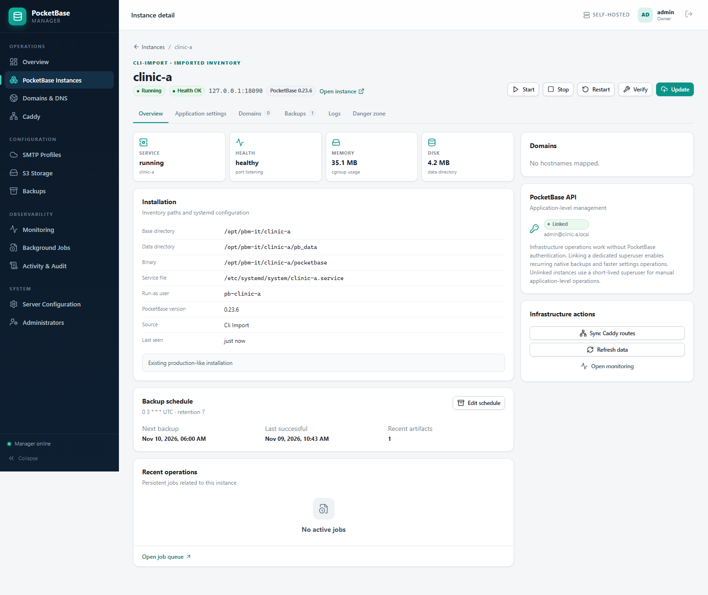
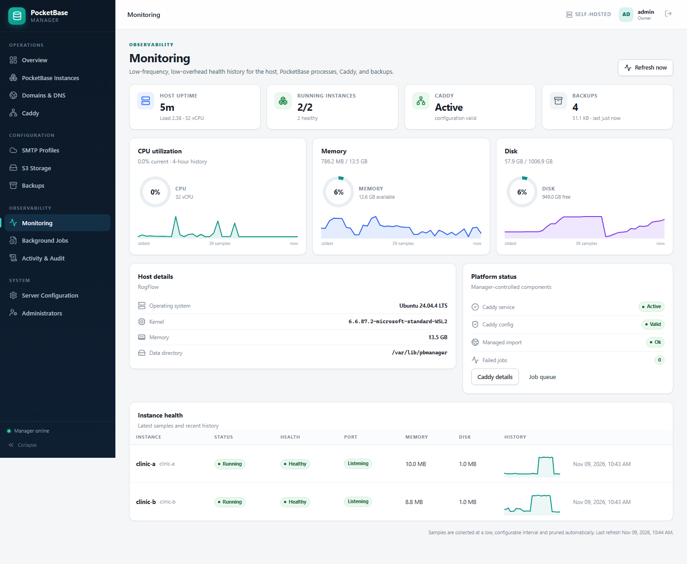
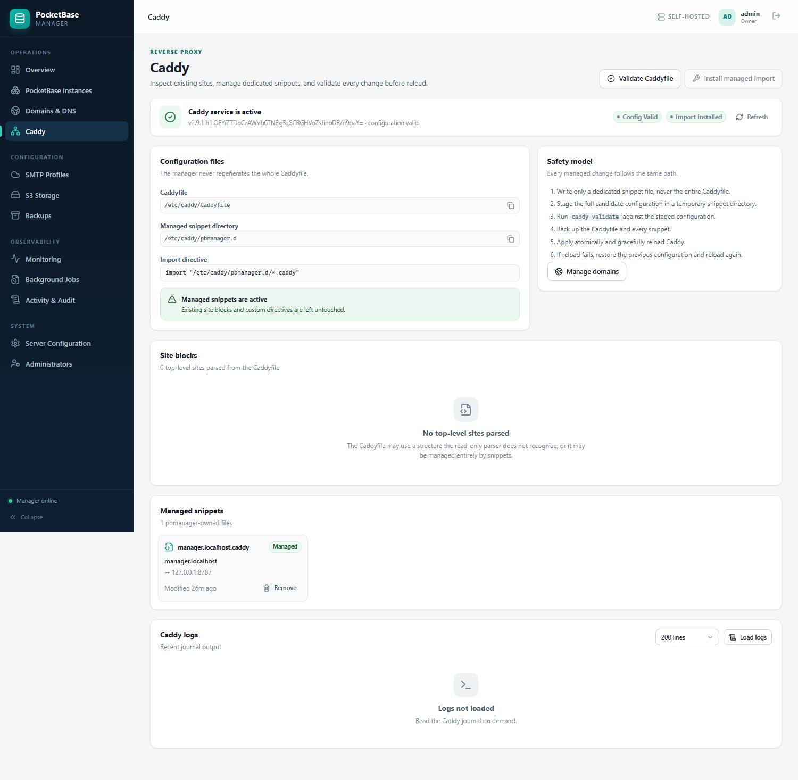
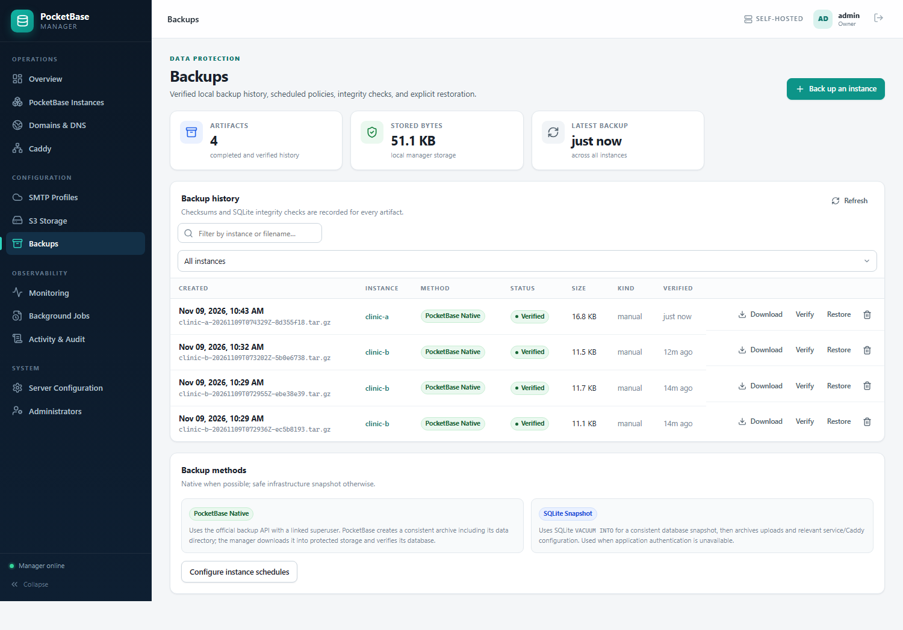
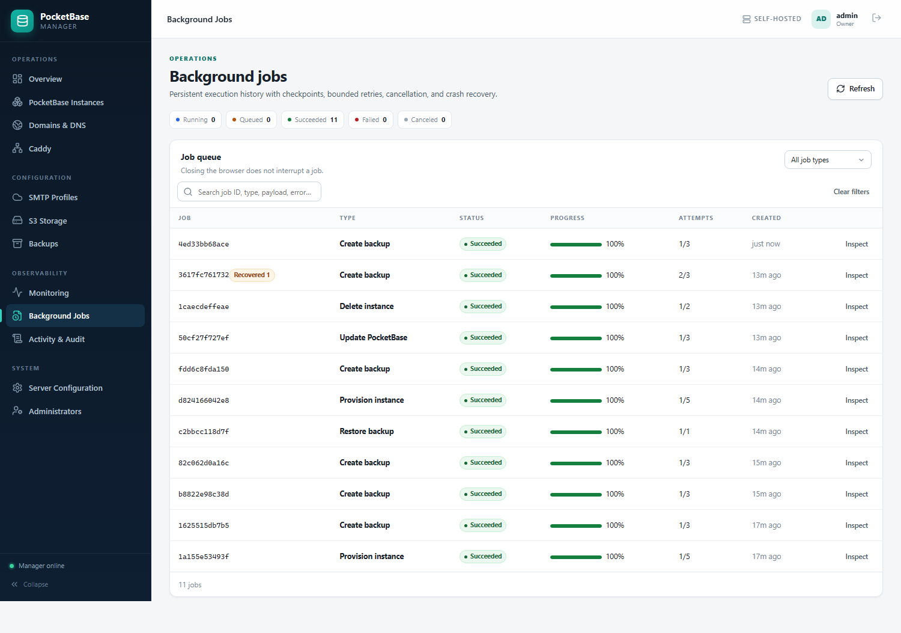
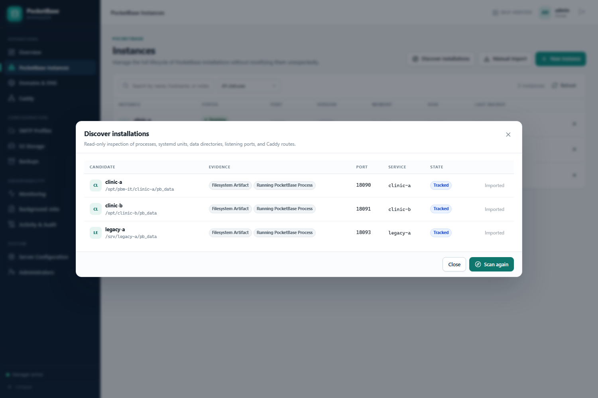

# PocketBase Infrastructure Manager

A self-hosted control plane for PocketBase fleets on a single Linux server. It inventories existing installations without touching them, provisions new ones safely, manages Caddy routes and Cloudflare DNS, applies SMTP/S3 settings through PocketBase's documented APIs, and keeps encrypted credentials, scheduled backups, monitoring, audit logs, and durable jobs in one small Go binary with an embedded React dashboard.



## Why this exists

Managing several PocketBase installations by hand is fragile: systemd units, ports, data directories, Caddy blocks, DNS records, SMTP settings, backups, and credentials all drift. Existing admin panels either assume one app or rewrite server configuration aggressively.

This manager is built around a few non-negotiable rules:

- **Existing PocketBase installations are never modified during discovery.** Import writes only manager inventory rows.
- **PocketBase authentication is never bypassed.** Application-level actions use the official superuser auth API. Infrastructure actions use systemd, files, and the documented binary interface.
- **The Caddyfile is never regenerated.** The manager emits dedicated snippets and adds one import directive, with validation, backups, and rollback.
- **Secrets stay encrypted at rest and out of API responses and logs.** AES-256-GCM with a root-only 0600 key.
- **The API cannot run arbitrary shell commands.** Every privileged operation is a typed, validated action with argument-only process execution.
- **The root CLI can recover administrator access even when the dashboard, database, or web service is broken.** Recovery does not depend on the web application.
- **No default credentials.** The first owner is created explicitly through the CLI or installer.

## Features

### Inventory and provisioning

- Read-only discovery of systemd units, running processes, ports, and filesystem artifacts.
- Safe import of an existing installation with no service, file, Caddy, or DNS changes.
- Durable provisioning state machine: validation, system user, directories, verified download, atomic binary install, systemd unit, health check, generated PocketBase superuser, optional Caddy/DNS, finalize.
- Managed instances run under a dedicated unprivileged user with a hardened unit.
- Update with a pre-update safety backup, verified release, atomic binary replacement, health verification, and binary rollback.
- Delete stops and disables the service, removes only the manager-owned unit, and moves data to a protected purge archive. Data is not recursively deleted.
- Idempotent steps survive manager crashes and job retries.

### Operations

- Start, stop, restart, verify, logs, and runtime health for each instance.
- Server, per-instance, job, backup, Caddy, and TLS health monitoring at a low, configurable frequency.
- Persistent job queue with priorities, bounded retries with backoff, cancellation, checkpoints, and crash recovery.
- Single-consumer enforcement using a root-owned `flock`; the CLI does not start a duplicate worker while the service is running.
- One-click manager updates from GitHub releases, checksum-verified and installed by a detached systemd unit with automatic health-check rollback.

### Manager releases

Push a version tag to publish Linux `amd64`/`arm64` binaries and a `checksums.txt` through the included GitHub Actions workflow:

```bash
git tag v1.0.2
git push origin v1.0.2
```

Owners can then use **Server configuration → Manager updates → Check GitHub → Install**. The updater requires a published (non-draft, non-prerelease) GitHub release. The first transition from a version older than 1.0.2 must be done once with `deploy-remote.sh` or the installer, because older builds do not include the self-update endpoint.

### Domains, Caddy, and Cloudflare

- Attach hostnames to instances; Cloudflare A records use manager ownership markers and never overwrite foreign records.
- Caddy route creation uses only a dedicated snippet. Existing sites and custom directives are preserved.
- Staged validation with `caddy validate` before any write, backups of the Caddyfile and snippets, graceful reload, and automatic rollback on reload failure.
- Domain removal deletes only manager-owned artifacts; DNS deletion requires explicit confirmation.
- Managed snippets can be removed from the Caddy page.
- TLS expiry and HTTPS health checks are exposed in monitoring.

### Profiles and backups

- Multiple SMTP profiles with STARTTLS/TLS/plain (loopback only) and PLAIN/LOGIN authentication.
- Multiple S3-compatible storage profiles with signed `ListObjectsV2` validation.
- Apply SMTP/S3 settings through PocketBase's documented `/api/settings` endpoint; no direct database modification.
- Scheduled backups with cron expressions (UTC), retention, and verification.
- **Native backups** use PocketBase's official backup API for a consistent database snapshot, then bundle uploads, the systemd unit, Caddy snippets, and instance metadata into one verified archive.
- **Fallback snapshots** use SQLite `VACUUM INTO` plus uploads and configuration when application credentials are not linked.
- Restore creates a safety backup first, stops the service, stages and validates the archive, keeps the previous data directory, starts the service, verifies health, and automatically rolls back on failure.
- Interrupted restores are journaled and recovered at startup.

### Security and access

- Owner / admin / viewer roles.
- Argon2id password hashing (64 MiB, 3 iterations).
- HttpOnly, Secure, SameSite=Strict session cookies and a double-submit CSRF token for every mutating API request.
- Login rate limiting and per-request API limits.
- Session listing and revocation.
- Last-owner protection: an owner cannot demote, disable, or delete the final owner.
- Origin validation, security headers, CSP, HSTS when served over HTTPS, request IDs, and redacted logs.
- Audit trail for logins, mutations, CLI recovery actions, job requests, and Caddy/DNS changes.
- Secure first-owner bootstrap with no default password.

## Screenshots

| Instances | Instance detail |
| --- | --- |
|  |  |

| Monitoring | Caddy |
| --- | --- |
|  |  |

| Backups | Background jobs |
| --- | --- |
|  |  |

| Automatic discovery |
| --- |
|  |

## Stack

- Go 1.24+ (built and tested with Go 1.27.3), standard-library HTTP routing.
- SQLite via `modernc.org/sqlite` (pure Go, WAL, `_txlock=immediate`).
- `golang.org/x/crypto/argon2` and `golang.org/x/term`.
- React 19, TypeScript, Vite, React Router, custom CSS, `lucide-react`.
- Assets embedded with `//go:embed`; production needs one binary, systemd, and no Node.js or Docker.
- Runs as root because it manages system users, systemd units, `/opt`, `/etc/caddy`, and backups. The web process binds loopback only and is designed to sit behind Caddy.

## Quick start

### Build

Requirements for the build host: Go 1.24+, Node.js 20+, npm.

```bash
./scripts/build.sh
```

This installs frontend dependencies, builds the embedded UI, runs the full Go test suite, and writes `dist/pbmanager` plus its SHA-256 file.

### Install on the server

```bash
sudo ./scripts/install.sh \
  --domain manager.example.com \
  --public-url https://manager.example.com \
  --admin-username admin
```

The installer:

1. Preserves existing config, data, and unit backups.
2. Installs the binary to `/usr/local/bin/pbmanager`.
3. Creates `/var/lib/pbmanager` (0700) and `/etc/pbmanager/config.json`.
4. Installs and starts a hardened `pbmanager.service`.
5. Verifies `/healthz`.
6. Bootstraps the first owner if none exists.
7. Optionally adds a managed Caddy route for the dashboard. `--skip-caddy` disables that.

It never touches existing PocketBase installations. Use `PBMANAGER_ADMIN_PASSWORD` only for unattended installs; otherwise the password is prompted without echo.

Full deployment guidance: [docs/DEPLOYMENT.md](docs/DEPLOYMENT.md).

### First login

Open the dashboard URL. Sign in with the owner account. Add an SMTP/S3/Cloudflare profile only when needed; infrastructure operations work without PocketBase application credentials.

### Import an existing installation

Use **Instances → Discover**, review the evidence, and import. Or run:

```bash
sudo pbmanager instances discover
sudo pbmanager instances import --name clinic-a \
  --base-dir /opt/clinic-a \
  --binary /opt/clinic-a/pocketbase \
  --data-dir /opt/clinic-a/pb_data \
  --port 8090 \
  --service clinic-a \
  --service-file /etc/systemd/system/clinic-a.service \
  --run-as pb-clinic-a
```

Import performs no writes outside the manager database. Link a PocketBase superuser later from the instance page to enable native backups and settings application.

## Recovery

The root CLI is independent of the web UI. It works while the service is stopped:

```bash
sudo systemctl stop pbmanager
sudo pbmanager --config /etc/pbmanager/config.json admin reset-password
sudo pbmanager --config /etc/pbmanager/config.json recover
sudo systemctl start pbmanager
```

`recover` verifies the manager database, creates or repairs an owner, revokes sessions, and reports service state. `db check`, `db snapshot`, and `db restore` provide an additional offline path.

See [docs/CLI.md](docs/CLI.md) and [docs/BACKUP-RECOVERY.md](docs/BACKUP-RECOVERY.md).

## Documentation

- [Architecture](docs/ARCHITECTURE.md)
- [Configuration reference](docs/CONFIGURATION.md)
- [Deployment](docs/DEPLOYMENT.md)
- [CLI reference](docs/CLI.md)
- [API reference](docs/API.md)
- [Backup and recovery](docs/BACKUP-RECOVERY.md)
- [Security model](docs/SECURITY.md)
- [Upgrade, rollback, uninstall](docs/UPGRADE.md)
- [Troubleshooting](docs/TROUBLESHOOTING.md)
- [Testing and verified evidence](docs/TESTING.md)
- [Limitations and environment notes](docs/LIMITATIONS.md)

## Repository layout

```
cmd/pbmanager          CLI and daemon entrypoint
internal/api           HTTP API, auth middleware, CSRF, audit
internal/app           shared wiring, job handlers, scheduler, worker lock
internal/auth          Argon2id, sessions, roles, login limiter
internal/cli           root recovery CLI
internal/config        bootstrap configuration
internal/jobs          durable job engine
internal/platform      argument-only process runner and safe filesystem helpers
internal/secret        AES-256-GCM secret box
internal/services      caddy, cloudflare, dns, discovery, instances, monitor,
                       pocketbase, smtp, storage, systemd, backup
internal/settings      editable server settings
internal/store         SQLite schema, migrations, repositories
web                    React dashboard and embedded assets
deploy                 example unit, Caddyfile, bootstrap config
docs                   operator and security documentation
scripts                build, install, upgrade, uninstall, integration tests
```

## Verified deployment

The complete system was built and exercised on Ubuntu 24.04 under WSL2 with real systemd, Caddy, and PocketBase 0.23.6:

- HTTPS dashboard through Caddy at `https://manager.localhost`.
- Imported a genuinely unmanaged PocketBase installation (`legacy-a`): unit hash, inode metadata, PID, and service health were unchanged.
- Imported an existing manager-created instance left running and unchanged.
- New instance provisioned from a verified official 0.23.6 archive with generated PocketBase superuser.
- Native backup bundle including uploads, restore with health verification, and upload recovery.
- Manager `SIGKILL` mid-job; systemd restarted it and the interrupted job was recovered and completed.
- Full WSL reboot; manager, Caddy, and PocketBase services auto-started healthy.
- Root CLI recovery and non-root rejection.
- Full Go test suite and production frontend build.

The exact evidence and remaining environment limitation are in [docs/TESTING.md](docs/TESTING.md) and [docs/LIMITATIONS.md](docs/LIMITATIONS.md).

## License

No license file is included; add one appropriate to your organization before redistribution.

